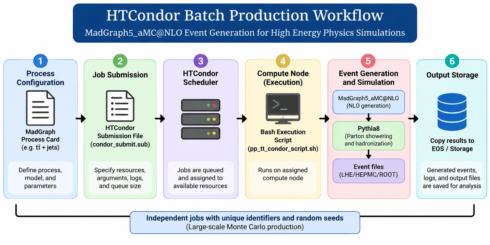

# HTCondor Batch Production for Monte Carlo Simulations

## Overview

HTCondor is a workload-management system used to distribute computational tasks across computing clusters.

In experimental high energy physics, HTCondor enables large-scale Monte Carlo event generation by submitting independent simulation jobs to available computing resources.

This section documents a Bash-based MadGraph5_aMC@NLO workflow for batch production, job scheduling, monitoring, and output management.

## 1. Simulation Workflow

The workflow integrates MadGraph5_aMC@NLO with HTCondor batch scheduling to support large-scale Monte Carlo event generation.



Independent simulation jobs are submitted to computing nodes through HTCondor. Each job executes a Bash script for MadGraph5_aMC@NLO event generation and Pythia8 showering.

Unique job identifiers and random seeds support independent event-generation runs.


## 2. Repository Files

| File | Description |
|---|---|
| `pp_tt_NLO_FxFx_condor.sh` | Bash script for configuring and executing MadGraph event-generation jobs |
| `pp_tt_NLO_FxFx_condor.sub` | HTCondor submission file defining job resources, arguments, logs, and queue size |

The Bash script handles generator configuration and event generation.

The HTCondor submission file controls execution through the computing cluster.

## 3. Example Physics Process

The supplied example defines top–antitop production with additional partons:

```text
generate p p > t t~ [QCD]
add process p p > t t~ j [QCD]
add process p p > t t~ j j [QCD]
```

The configuration targets NLO event generation with Pythia8 showering and FxFx merging.

The appropriate perturbative settings, matching scales, flavour scheme, and shower configuration require validation for the intended physics calculation.

## 4. Batch Job Configuration

The supplied HTCondor submission file specifies:

| Parameter | Configuration |
|---|---|
| Job universe | Vanilla |
| Number of jobs | 4 |
| Requested CPUs per job | 4 |
| Requested memory per job | 4000 MB |
| Job identifier | HTCondor process index |
| Standard output | `logs/output_$(Process).log` |
| Standard error | `logs/error_$(Process).err` |
| Event log | `logs/condor.log` |

Each job requests 100,000 generated events at a proton–proton centre-of-mass energy of 13.6 TeV.

These values describe the supplied configuration rather than universal resource requirements.

## 5. Requirements

The following components are required:

- HTCondor workload-management system
- MadGraph5_aMC@NLO
- Compatible Python environment
- LHAPDF6
- Pythia8
- Accessible temporary and persistent storage
- Valid process-generation and shower configurations

The generator installation and required external libraries must be accessible from the assigned execution nodes.

## 6. Job Submission

Create a directory for HTCondor logs:

```bash
mkdir -p logs
```

Set execution permission:

```bash
chmod +x pp_tt_NLO_FxFx_condor.sh
```

Submit the batch jobs:

```bash
pp_tt_NLO_FxFx_condor.sub
```

The job submission command reads the resource configuration and places jobs into the HTCondor queue.

**Note:** The supplied scripts contain site-specific configuration and require the checks described in Section 9 before execution.

## 7. Job Monitoring

Check active and queued jobs:

```bash
condor_q
```

Display completed-job history:

```bash
condor_history
```

Inspect the standard output and error logs:

```bash
cat logs/output_0.log
```

```bash
cat logs/error_0.err
```

Remove a submitted job when necessary:

```bash
condor_rm <JOB_ID>
```

The job identifier must correspond to an existing HTCondor submission.

## 8. Output Management

The supplied Bash workflow creates a temporary working directory for each job.

Event generation is performed inside this directory.

Generated files are subsequently copied to a designated storage location.

A reliable production workflow should verify successful output transfer before removing temporary files.

Generated event samples, intermediate files, and large simulation outputs should generally remain outside the source-code repository.

## 9. Configuration and Validation

Before execution, the following components require verification:

- Valid MadGraph installation path
- Compatible Python and LHAPDF library paths
- Accessible output destination
- Unique temporary directories across repeated submissions
- Successful process generation and shower execution
- Valid matching and merging settings
- Successful output transfer before temporary-file cleanup
- Cluster-supported CPU, memory, and runtime requests

The supplied scripts are examples of a site-dependent production workflow, not a universal batch configuration.


## 10. References

- [HTCondor User Manual](https://htcondor.readthedocs.io/en/main/users-manual/)
- [HTCondor File Transfer Documentation](https://htcondor.readthedocs.io/en/main/users-manual/file-transfer.html)
- [MadGraph5_aMC@NLO](https://launchpad.net/mg5amcnlo)
- [Pythia8 Documentation](https://pythia.org/documentation/)
