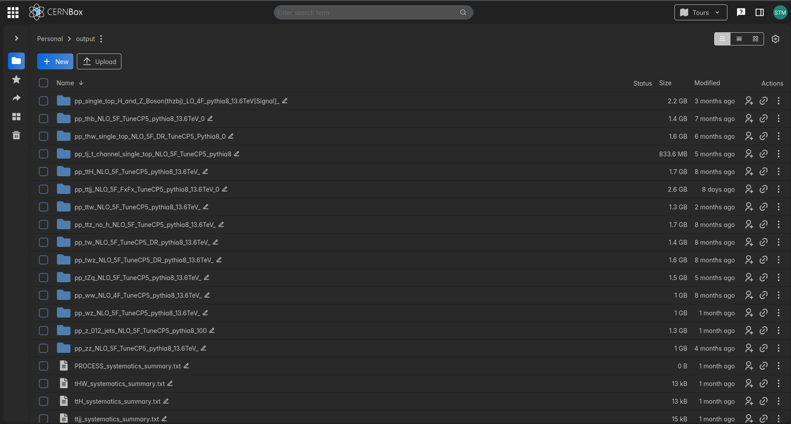

# Generated Monte Carlo Samples

## Overview

Monte Carlo datasets generated for simulated proton–proton collisions at **√s = 13.6 TeV**, supporting experimental high-energy physics studies.

The sample production includes signal and background processes using **MadGraph5_aMC@NLO**, with **Pythia8** for parton showering and hadronization.

Both **4-flavour (4F)** and **5-flavour (5F)** schemes were considered, depending on the physics process.

## MC Sample Production

The following image presents an overview of the generated Monte Carlo datasets.

## Data Availability

The original simulation datasets are maintained in CERNBox. This repository provides documentation of the sample-production workflow rather than hosting the full datasets.
