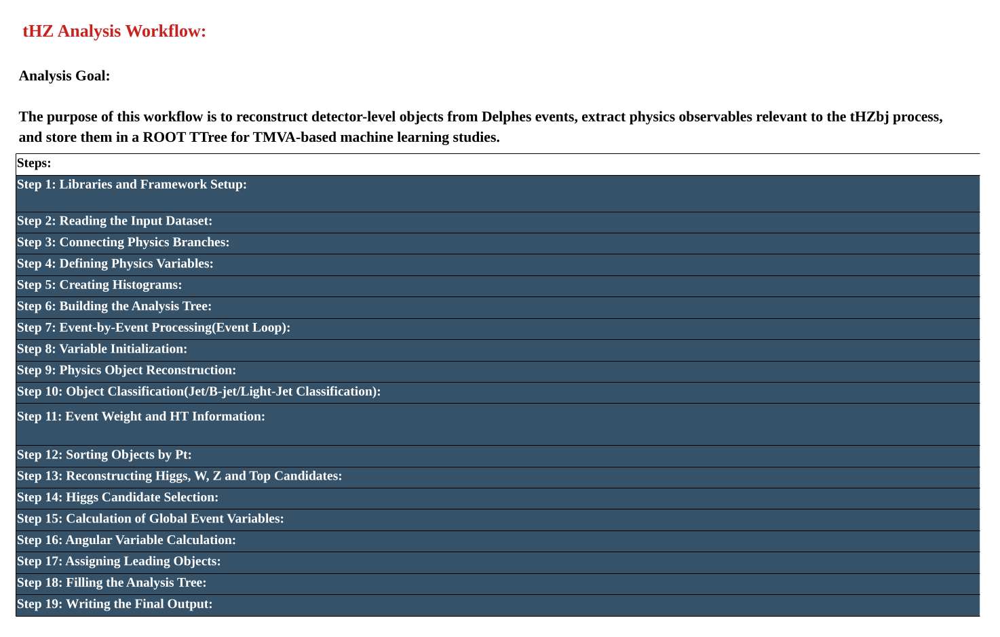

# ROOT-Based Event Reconstruction and Physics Analysis

## Overview

ROOT is a scientific data analysis framework widely used in experimental high energy physics for processing collision data, reconstructing physics observables, and performing statistical and computational analyses.

This section documents ROOT-based event analysis techniques applied to simulated high energy particle collisions.

The analysis focuses on detector-level event processing, physics-object reconstruction, kinematic variable calculation, and preparation of structured datasets for multivariate analysis.

## 1. Analysis Framework

The computational workflow integrates several software packages:

**MadGraph5_aMC@NLO → Pythia8 → Delphes → ROOT → TMVA**

ROOT processes the detector-level information produced by Delphes and provides tools for event reconstruction, histogramming, data organization, and visualization.

## 2. tHZbj Event Reconstruction and Analysis

The tHZbj analysis investigates the reconstruction of physics objects and kinematic observables associated with single-top production in association with a Higgs boson and a Z boson.

The analysis workflow includes:

- Reading simulated detector-level events from Delphes ROOT files.
- Accessing reconstructed leptons, jets, and missing transverse momentum.
- Identifying and classifying jets, including b-tagged jets.
- Calculating event-level kinematic observables.
- Reconstructing Higgs, W, Z, and top-quark candidates.
- Studying invariant masses and angular observables.
- Organizing reconstructed variables into ROOT TTrees.
- Preparing structured datasets for TMVA-based multivariate analysis.

## 3. Event Reconstruction Workflow

The analysis follows a structured sequence, beginning with detector-level event information and ending with reconstructed physics variables stored in ROOT TTrees.

### tHZbj Analysis Workflow

The workflow illustrates the main stages of event processing, physics-object reconstruction, kinematic variable calculation, and output preparation for machine-learning applications.

## 4. Analysis Output

The ROOT-based processing produces structured event information containing reconstructed physics observables.

The resulting ROOT TTrees provide input variables for subsequent multivariate classification using TMVA.

This separation between event reconstruction and machine-learning analysis supports systematic organization of the computational workflow.

## 5. Software and Tools

| Software | Purpose |
|---|---|
| ROOT | Event processing, histogramming, and data analysis |
| Delphes | Fast detector simulation |
| C++ | Event reconstruction and analysis implementation |
| ROOT TTree | Structured storage of physics observables |
| TMVA | Multivariate classification and machine learning |

## 6. Related Documentation

- [ROOT & TMVA Installation](../Software_Installation/ROOT_TMVA/Installation.md)
- [Delphes Installation](../Software_Installation/Delphes/Installation.md)
- [Monte Carlo Simulation](../Monte_Carlo_Simulation/README.md)

## 7. References

- [ROOT Data Analysis Framework](https://root.cern/)
- [ROOT TTree Documentation](https://root.cern/doc/master/classTTree.html)
- [ROOT TMVA Documentation](https://root.cern/manual/tmva/)
- [Delphes Official Documentation](https://delphes.github.io/)
